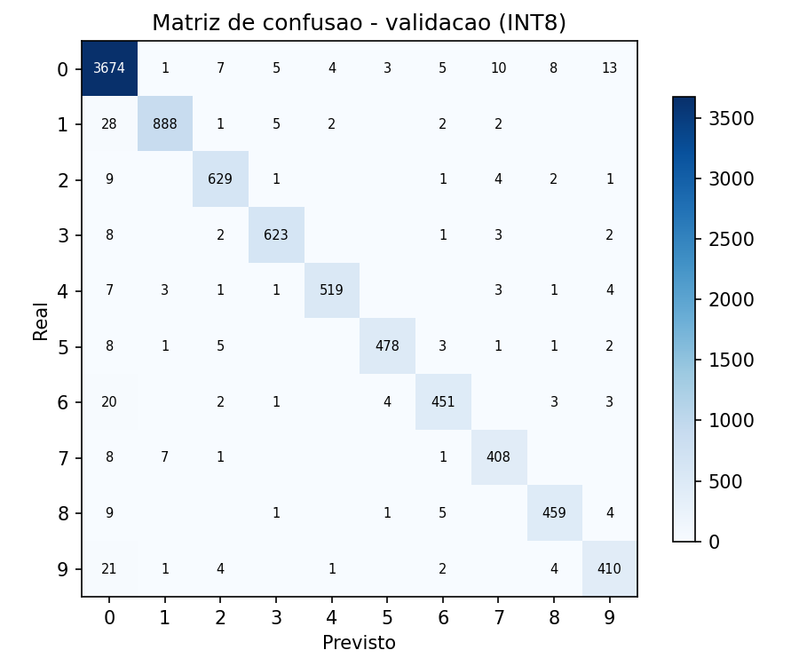

# Resultados do classificador de dígitos

Gerado automaticamente por `gerar_relatorio_resultados.py`, reavaliando os arquivos
`modelo_digito.h5` (float) e `modelo_digito.tflite` (INT8) já treinados — **não** re-treina
nada, só mede. Para reproduzir do zero, rode `treinar_classificador_digitos.py` (ver
[README.md](../README.md)).

## Resumo

| Métrica | Valor |
|---|---|
| Acurácia — modelo float (`modelo_digito.h5`), validação por foto | **95.46%** |
| Acurácia — modelo INT8 (`modelo_digito.tflite`), validação por foto | **95.38%** (7037/7378) |
| Acurácia — modelo INT8, 24 recortes de fotos da ESP32-CAM (domínio) | **100.00% (24 amostras)** — esses recortes entram no fine-tuning, então **não medem generalização** |
| Parâmetros do modelo | 72,442 |
| Tamanho `modelo_digito.tflite` | 81.5 KB |
| Tamanho `modelo_esp32.tflite` (segmentação, referência) | 11.8 KB |
| Total de imagens em `dataset/digits/` | 49,038 |
| Recortes na validação (divisão por foto, 15 % das fotos) | 7,378 |

## Teste independente (pastas `test` do Dryad, fora do treino)

Cada imagem 200×60 é cortada em N fatias iguais (como no firmware) e cada fatia vai ao classificador INT8.
Gerado por [`ocr/avaliar_teste_publico.py`](../../ocr/avaliar_teste_publico.py); as linhas ficam em
[`medicoes/ocr_teste.csv`](../../medicoes/ocr_teste.csv).

| Modelo | Imagens | Leitura exata | Dígitos certos | CER |
|---|---|---|---|---|
| só Fase A (sem fine-tuning) | 1894 | 1750 (92.4 %) | 97.3 % | 0.0263 |
| Fase A + B (versionado) | 1894 | 1758 (92.8 %) | 97.7 % | 0.0228 |

Para comparação: o classificador **antigo**, treinado com essas mesmas pastas `test` dentro do treino, tirava
**95,6 %** de leituras exatas e 98,6 % dos dígitos nelas (número contaminado, mantido só para mostrar o tamanho do vazamento).

## Acurácia por classe (INT8, validação)

| Dígito | Exemplos no dataset | Acurácia |
|---|---|---|
| 0 | 20398 | 97.21% |
| 1 | 4991 | 95.04% |
| 2 | 3856 | 93.33% |
| 3 | 3580 | 97.17% |
| 4 | 3037 | 95.88% |
| 5 | 2897 | 95.27% |
| 6 | 2764 | 92.18% |
| 7 | 2474 | 90.84% |
| 8 | 2572 | 94.36% |
| 9 | 2469 | 91.64% |

## Matriz de confusão (INT8, validação)

## Como verificar independentemente

1. Clone o repositório e siga o "Como rodar" do [README.md](../README.md) (baixa os datasets,
   monta o `dataset/digits/`).
2. Rode `python gerar_relatorio_resultados.py` — ele recalcula tudo acima a partir dos
   arquivos `modelo_digito.h5`/`.tflite` já commitados, sem precisar re-treinar (leva
   segundos/poucos minutos, não os ~20min do treino completo).
3. Os números crus, sem arredondamento, também ficam em `resultados_treino.json`.
