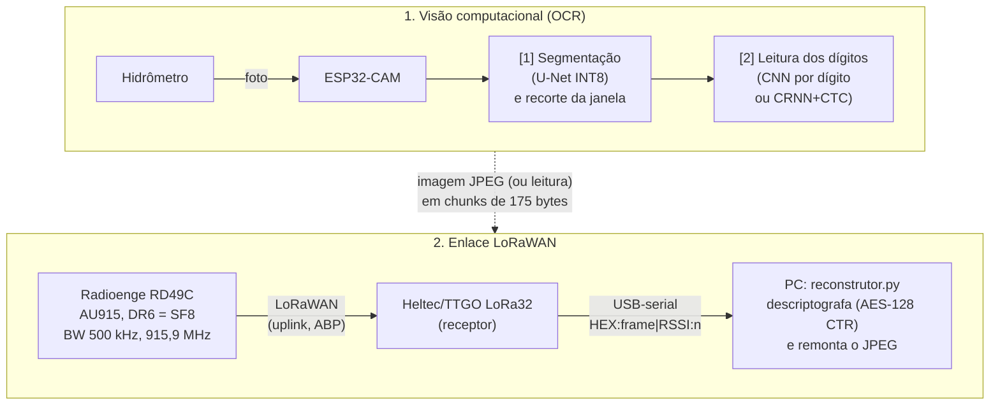

# Codigo-do-TCC2

Compilado de todos os códigos usados no TCC2: **leitura automática de hidrômetro com
ESP32-CAM e envio da imagem/leitura por LoRaWAN**.

O trabalho une duas frentes que se complementam:

1. **Visão computacional embarcada (OCR)** — a partir da foto de um hidrômetro de "rodinhas"
   (*word-wheel*), localizar a janela de dígitos e ler o valor (m³) com redes neurais pequenas
   o bastante para rodar em microcontrolador (TFLite Micro / INT8).
2. **Enlace LoRaWAN** — transportar a imagem (ou a leitura) da ESP32-CAM até um receptor
   usando um módulo Radioenge RD49C, no plano de canais AU915 e dentro das regras da Anatel.

---

## Sumário

- [Visão geral da arquitetura](#visão-geral-da-arquitetura)
- [Estrutura do repositório](#estrutura-do-repositório)
- [Como reproduzir](#como-reproduzir)
- [Hardware utilizado](#hardware-utilizado)
- [1. Rede LoRaWAN (`Rede/`)](#1-rede-lorawan-rede)
- [2. PoC de redução de imagem (`poc_diminuicao_imagem/`)](#2-poc-de-redução-de-imagem-poc_diminuicao_imagem)
- [3. OCR "na nuvem"/PC (`ocr_cloud/`)](#3-ocr-na-nuvempc-ocr_cloud)
- [4. OCR na borda — treino e modelos (`TreinoEModelosOCRNaBorda/`)](#4-ocr-na-borda--treino-e-modelos-treinoemodelosocrnaborda)
- [5. Classificador de dígitos + dataset (`ModeloEDataset/`)](#5-classificador-de-dígitos--dataset-modeloedataset)
- [6. Firmware de debug/calibração (`test_images/`)](#6-firmware-de-debugcalibração-test_images)
- [Configuração de segredos](#configuração-de-segredos)
- [Datasets e créditos](#datasets-e-créditos)
- [Histórico de branches](#histórico-de-branches)
- [Limitações conhecidas e próximos passos](#limitações-conhecidas-e-próximos-passos)
- [Autores](#autores)

---

## Visão geral da arquitetura



Os dois estágios de OCR já foram **testados juntos em uma ESP32-CAM real**
(ver [`test_images/`](test_images/debug_ocr_esp32cam/README.md)). O enlace LoRaWAN foi validado
separadamente transmitindo a imagem em chunks (ver [`Rede/`](#1-rede-lorawan-rede)). A integração
final (OCR no dispositivo → só a leitura trafega por LoRaWAN) é um dos próximos passos.

---

## Estrutura do repositório

```
Codigo-do-TCC2/
├── Rede/                          Firmwares do enlace LoRaWAN (Arduino IDE)
│   ├── transmissor_esp32cam/      Transmissor único: câmera (CAPTURE), reenvio (RESEND), envio vindo do PC (SEND), teste de enlace (SENDALL) e modo autônomo com deep sleep (AUTO/STOP/SLEEP, ainda não testado em placa)
│   ├── receptor_lora32/           Firmware do receptor (Heltec/TTGO LoRa32)
│   └── requirements.txt           Igual ao requirements.txt da raiz
├── files/                         Cópias antigas
│   └── reconstrutor.py            Versão antiga do reconstrutor (use o da raiz)
├── enlace.py                      PC: parâmetros do enlace (bloco, cabeçalho) e parser LoRaWAN compartilhados
├── reconstrutor.py                PC: lê a serial do receptor, descriptografa e remonta o JPEG
├── decode_lorawan.py              PC: decodifica/descriptografa uplinks e mostra quais chunks faltam
├── orchestrator.py                PC: envia a imagem em chunks (SEND:), confere o recebimento e reenvia o que faltou
├── analise_tempo_no_ar.py         PC: calcula pacotes, tempo no ar e tempo total de envio (`--verificar` confere a fórmula)
├── esp32cam_jpeg_hex_chunks/      Sketch do protótipo antigo (serial → PC)
├── main.py, decode.py             Protótipo antigo: gravam a serial em raw_data.txt e remontam image.jpg
├── mqtt_bridge.py                 Protótipo antigo: serial → ChirpStack (MQTT)
├── config.py, .env.example        Leitura do .env e modelo das variáveis (chaves, rede, portas)
├── requirements.txt               Dependências dos scripts da raiz (pyserial, pycryptodome, paho-mqtt)
├── scripts/download_datasets.py   Baixa os datasets públicos (eles não ficam no Git)
├── poc_diminuicao_imagem/         PoC em C++/OpenCV: redução/binarização de imagem p/ caber no LoRa
├── ocr_cloud/                     OCR em Python (PC/nuvem): segmentação TFLite + CNN de dígitos
├── TreinoEModelosOCRNaBorda/      Treino do detector (U-Net QAT) e do leitor CRNN+CTC p/ ESP32
├── ModeloEDataset/                Pipeline do classificador de dígitos (CNN) + datasets + relatórios
├── test_images/                   Fotos da ESP32-CAM + firmware de debug/calibração com OCR on-device
├── image.jpg, imagem_recebida.jpg, imagem_parcial.jpg, raw_data.txt, raw_image_data.txt
│                                  Amostras/saídas dos scripts de enlace (exemplos de captura)
└── README.md
```

> **Atenção ao enlace:** o transmissor é um sketch único,
> [`Rede/transmissor_esp32cam/`](Rede/transmissor_esp32cam/transmissor_esp32cam.ino), que usa o
> cabeçalho binário de 6 bytes (id da leitura + índice base 0 + total). Os scripts do PC (`reconstrutor.py`,
> `decode_lorawan.py`, `orchestrator.py`) usam o mesmo formato e o mesmo tamanho de bloco,
> definidos em [`enlace.py`](enlace.py). Se mudar o `CHUNK_DATA_SIZE` do firmware, mude também o de
> `enlace.py`.

> Cada pasta de OCR tem uma abordagem própria (ver tabela abaixo). Elas **não dependem umas das
> outras** — cada uma tem seu próprio dataset, `requirements.txt` e scripts.

| Pasta | Abordagem de leitura | Segmentação | Onde roda |
|---|---|---|---|
| `ocr_cloud/` | CNN de 1 caractere (68×68) sobre 6 recortes iguais; há também teste com CRNN+CTC | U-Net INT8 384×384 | PC / nuvem |
| `TreinoEModelosOCRNaBorda/` | **CRNN + CTC** (visor inteiro 48×224, classe *blank* = 10), float e QAT | U-Net com QAT, 384×384 | Treino no PC → ESP32 |
| `ModeloEDataset/` | CNN de dígito (28×28, 72 mil parâmetros) sobre N fatias | U-Net INT8 (`modelo_esp32.tflite`) | Treino no PC → ESP32-CAM |

---

## Como reproduzir

### Python e dependências por pasta

Cada pasta tem seu próprio ambiente (`.venv` + `requirements.txt`). Não instale tudo no mesmo venv.
Os comandos abaixo usam a sintaxe do Windows (`.venv\Scripts\...`); no Linux/WSL troque por
`.venv/bin/...`.

| Pasta | Python | Dependências | O que foi verificado |
|---|---|---|---|
| Raiz (scripts do enlace e do protótipo) e `Rede/` | 3.9 ou superior | `requirements.txt` (pyserial, pycryptodome, paho-mqtt; igual ao de `Rede/`) | Rodado com 3.13.9 |
| `ocr_cloud/` | **3.13** | `ocr_cloud/requirements.txt` (TensorFlow 2.21.0, Keras 3.15.1) | Instalado em venv limpo (3.13.9) e `modelo_ocr.keras` carregado com sucesso |
| `TreinoEModelosOCRNaBorda/` | **Linux / WSL2** (GPU opcional) | `requirements.txt` da pasta: é um `pip freeze` com pacotes NVIDIA/CUDA que não têm wheel para Windows (TensorFlow 2.21.0, Keras 3.15.1, tf_keras 2.21.0) | Python **3.11 a 3.13**: a resolução dos wheels Linux x86_64 foi conferida nas três versões; o treino em si não foi reexecutado |
| `ModeloEDataset/` | **3.10** (TensorFlow 2.16.1 só tem wheels até 3.12) | `ModeloEDataset/requirements.txt` | Instalado em venv limpo com Python 3.10.11 (versões fixadas, `pip check` sem erros); modelo `.h5` e `.tflite` carregados |
| `poc_diminuicao_imagem/` | — | g++, OpenCV 4 e Qt6 em `/usr/include` (Linux/WSL, ver `makefile`) | — |
| Firmwares `.ino` | — | Arduino IDE + core ESP32; biblioteca **LoRa** (Sandeep Mistry); para o firmware de debug, uma biblioteca de TensorFlow Lite Micro | Não compilados nesta revisão |

### Passo a passo

**1. Clonar e configurar o `.env`** (chaves, rede e portas; veja [Configuração de segredos](#configuração-de-segredos)):

```bash
git clone https://github.com/Marcelo-122/Codigo-do-TCC2.git
cd Codigo-do-TCC2
copy .env.example .env      # Linux/macOS: cp .env.example .env
```

**2. Baixar os datasets** (só é necessário para treinar; a inferência usa os modelos e as fotos
versionados). Os datasets públicos **não ficam no Git**:

```bash
pip install kaggle          # e defina KAGGLE_API_TOKEN (token em kaggle.com/settings/api) no ambiente ou no .env
python scripts/download_datasets.py --listar    # fontes e licenças
python scripts/download_datasets.py             # baixa os do Kaggle
```

| Pasta | Precisa de | Onde fica |
|---|---|---|
| `ocr_cloud/` (treino) | Digits 0–9 | `ocr_cloud/num_dataset/` |
| `TreinoEModelosOCRNaBorda/` | Yandex.Toloka + Digits 0–9 | `dataset/images/`, `dataset/masks/`, `dataset/num/`; depois `gerar_blackout.py` e `gerador_sintetico.py` criam `visores_blackout/` e `visores_sinteticos/` |
| `ModeloEDataset/` | Yandex.Toloka + Word-Wheel (Dryad, **download manual**, 2,8 GB) | `dataset/images/`, `dataset/masks/`, `dataset/Word-Wheel_Water_Meter_Dataset/`. As fotos de cartaz do TCC I não estão no repo: use `--cartaz PASTA` em `preparar_dataset_dominio_esp32.py` |

**3. Rodar cada parte** (detalhes nas seções abaixo):

| Objetivo | Comandos |
|---|---|
| Receber e remontar a imagem (enlace) | `python -m venv .venv`, `.venv\Scripts\pip install -r requirements.txt`, `.venv\Scripts\python reconstrutor.py`; veja [seção 1](#1-rede-lorawan-rede) |
| OCR no PC, só inferência | `cd ocr_cloud`, venv + `pip install -r requirements.txt`, `python src\test_model_ocr_cloud_poc.py` ([seção 3](#3-ocr-na-nuvempc-ocr_cloud)) |
| Treinar o OCR do `ocr_cloud` | mesmo venv, depois do passo 2: `python src\train_model_ocr_cloud.py` |
| Treinar detector e leitor CRNN+CTC | em WSL/Linux, `cd TreinoEModelosOCRNaBorda`, depois do passo 2 ([seção 4](#4-ocr-na-borda--treino-e-modelos-treinoemodelosocrnaborda)) |
| Treinar o classificador de dígitos | `cd ModeloEDataset`, Python 3.10, depois do passo 2 ([seção 5](#5-classificador-de-dígitos--dataset-modeloedataset)) |

---

## Hardware utilizado

| Peça | Função |
|---|---|
| **ESP32-CAM (AI-Thinker)** | Captura a imagem (QQVGA 160×120 em escala de cinza, convertida para JPEG qualidade 90) e, na versão de debug, roda o OCR |
| **Radioenge RD49C** | Módulo LoRaWAN (comandos `AT+...`), ligado à ESP32-CAM por UART (RX = GPIO 15, TX = GPIO 14) |
| **Heltec / TTGO LoRa32 V2** | Receptor LoRa: SS = 18, RST = 14, DIO0 = 26; imprime os frames recebidos na serial |
| **PC** | Roda `reconstrutor.py`, treina os modelos e (no protótipo antigo) hospeda o ChirpStack |
| **Gateway/ChirpStack** *(só protótipo antigo)* | Servidor LoRaWAN recebendo pacotes Semtech UDP / MQTT |

### Parâmetros do enlace (tabela única)

Todos os componentes (Radioenge, transmissor, receptor, scripts do PC) usam estes valores.

| Parâmetro | Valor | Onde é definido / fonte |
|---|---|---|
| **Plano de canais** | AU915 (915–928 MHz) | Manual Radioenge (RD49C); Ato 14.448, item 10.1 |
| **Canal** | **Fixo, 500 kHz, 915,9 MHz**: canal 64 na numeração do RP002 (base 0) = canal 65 na do manual Radioenge (base 1) | `receptor_lora32.ino` (`FREQ_HZ`) |
| **Máscara de canais** | `AT+CHMASK=0000:0000:0000:0000:0001:0000` | Manual, seção 5.2.15 |
| **Datarate** | **DR6 = SF8 / BW 500 kHz**, `AT+DR=6` com `AT+ADR=0` (o `AT+DR` só vale com o ADR desligado) | Manual, Tabelas 7 e 5.2.2; `receptor_lora32.ino` |
| **Camada física** | Código 4/5, preâmbulo de 8 símbolos, CRC ligado, cabeçalho explícito, sync word `0x34` | Padrão LoRaWAN; `receptor_lora32.ino` |
| **Ativação / porta** | ABP, FPort 1 (`AT+SENDB=01:<hex>`) | `transmissor_esp32cam.ino` |
| **Potência** | Máx. +20 dBm (100 mW), fixa no módulo (não há comando `AT` para mudar) | Manual, especificações |
| **Payload máximo (DR6)** | 222 B | Manual, Tabela 8 |
| **Bloco de imagem por pacote** | **175 B** de dados + 6 B de cabeçalho = **181 B** de payload (41 B de folga) | `CHUNK_DATA_SIZE` no `.ino` e em `enlace.py` |
| **Cabeçalho do chunk** | `uint16` id da leitura (sorteado a cada `CAPTURE`) + `uint16` índice (base 0) + `uint16` total, big-endian | `enlace.py` |
| **Intervalo entre pacotes** | 7 s | `SEND_INTERVAL_MS` no `.ino`; `orchestrator.py` |
| **Captura** | QQVGA 160×120, escala de cinza, convertida em JPEG qualidade 90 (`fmt2jpg`, escala 1–100) | `JPEG_QUALITY` no `.ino` |
| **Tamanho do JPEG** | Medido: 2.460 a 4.209 B (média 3.640 B, 4 capturas). **Referência de projeto: 4.300 B** | `analise_tempo_no_ar.py` |

**Tempo no ar** (SF8 / 500 kHz, bloco de 175 B, imagem de referência de 4.300 B), calculado por
[`analise_tempo_no_ar.py`](analise_tempo_no_ar.py) com a fórmula da Semtech (AN1200.13):

| Grandeza | Valor |
|---|---|
| Pacotes | 25 |
| Tempo no ar por pacote (194 B na camada física) | 135,8 ms |
| **Tempo total de rádio** | **3,35 s** |
| Tempo total de envio (com intervalo de 7 s) | ≈ 168 s |

Para outros tamanhos de imagem ou bloco: `python analise_tempo_no_ar.py --imagem 3000 --bloco 175`.
`--verificar` confere a fórmula com um valor de referência externo.

**Enquadramento na regulamentação (Ato Anatel nº 14.448/2017, item 10.3):** sistemas de modulação
digital precisam de largura de faixa a 6 dB ≥ 500 kHz (10.3.1), potência de pico ≤ 1 W (10.3.2) e
densidade espectral ≤ 8 dBm em 3 kHz (10.3.3). Com +20 dBm espalhados em 500 kHz, a densidade fica
em torno de −2 dBm em 3 kHz (estimativa que supõe espectro plano). Esse enquadramento dispensa o
salto de frequência e o limite de ocupação por canal do item 10.2. A largura a 6 dB do LoRa de
500 kHz nominais deve ser confirmada pela homologação do módulo, e antenas com ganho acima de
6 dBi exigem reduzir a potência (item 10.5). A alternativa com salto de frequência (item 10.2.5.2,
35 canais de 125 kHz, `AT+DR=5`) também seria válida, mas não é a usada aqui.

> Atenção: **nunca** use `CHMASK` com menos de 35 canais em BW = 125 kHz: não se enquadra em
> nenhum dos dois itens da regulamentação.

---

## 1. Rede LoRaWAN (`Rede/`)

### Fluxo

1. A ESP32-CAM (firmware em [`Rede/transmissor_esp32cam/`](Rede/transmissor_esp32cam/transmissor_esp32cam.ino)) recebe `CAPTURE` pela serial, tira uma foto JPEG e a divide em **chunks de 175 bytes**.
2. Cada chunk vai com um cabeçalho binário de 6 bytes — `uint16 id` (da leitura) + `uint16 index` +
   `uint16 total` (big-endian) — e é enviado ao Radioenge com `AT+SENDB=01:<hex>` (FPort 1).
3. O **receptor LoRa32** escuta em 915,9 MHz / SF8 / BW 500 kHz e escreve na serial uma linha por
   frame: `HEX:<bytes do frame>|RSSI:<valor>`.
4. O **`reconstrutor.py`** lê essas linhas, extrai o `FRMPayload`, **descriptografa com a AppSKey**
   (AES-128 em modo CTR, conforme a especificação LoRaWAN), junta os chunks e grava
   `imagem_recebida.jpg`. Chunks faltantes geram `imagem_parcial.jpg` (com zeros nos buracos).
   Para completar, mande `RESEND:<índices base 0>` no transmissor **com o script ainda rodando**: o
   `RESEND` reenvia a mesma foto. Não use `CAPTURE` para isso, porque ele tira outra foto.

### Firmwares (Arduino IDE)

| Sketch | Placa | Observações |
|---|---|---|
| `Rede/transmissor_esp32cam/` | AI Thinker ESP32-CAM | **Transmissor único.** Comandos pela serial: `CAPTURE` (captura e envia), `RESEND:2,7,15` (reenvia chunks da última captura), `SEND:<id>:<índice>:<total>:<hex>` (dados vindos do PC, usado pelo `orchestrator.py`), `SENDALL:<n>` (teste de enlace sem câmera, payload fixo) ou `AT...` (repassado ao Radioenge). Retentativas quando o módulo está ocupado. Intervalo entre chunks: `SEND_INTERVAL_MS` (7000 ms). |
| `Rede/receptor_lora32/` | TTGO/Heltec LoRa32 V2 | Biblioteca **LoRa** (Sandeep Mistry). Frequência fixa 915,9 MHz. |

### Rodando o receptor no PC

Na raiz do repositório (o `reconstrutor.py`, o `config.py` e o `requirements.txt` ficam lá):

```bash
python -m venv .venv
# Windows
.venv\Scripts\pip install -r requirements.txt
# Preencha o .env com as chaves e RX_SERIAL_PORT (ver "Configuração de segredos")
.venv\Scripts\python reconstrutor.py
# Em outro terminal serial (ou no Monitor Serial do transmissor) envie:  CAPTURE
```

Para enviar uma imagem do PC pelo transmissor de teste (`Rede/transmissor_esp32cam/`), com o `.env`
preenchido (`TX_SERIAL_PORT`, `RX_SERIAL_PORT`, chaves e `IMAGE_PATH`):

```bash
.venv\Scripts\python orchestrator.py
```

### Protótipo anterior (scripts na raiz)

Primeira abordagem, **sem rádio real**: a ESP32-CAM manda os chunks por USB-serial e o PC os
injeta num servidor ChirpStack.

| Arquivo | Função |
|---|---|
| `esp32cam_jpeg_hex_chunks/` | Sketch: captura JPEG e envia `BEGIN,<bytes>,<chunks>` / `CHUNK,<i>,<len>,<hex>` / `END,<crc32>` pela serial (85 bytes por chunk; protótipo antigo, fora do enlace final) |
| `main.py` + `decode.py` | Gravam a saída serial em `raw_data.txt` e reconstroem `image.jpg` conferindo o CRC32 |
| `mqtt_bridge.py` | Publica cada chunk como uplink no tópico MQTT do ChirpStack |

O `mac_simulator.py` (simulador de gateway via Semtech UDP, que usava `868.1` MHz / `SF7BW125`) foi
removido: era só um teste e não faz parte do fluxo final, que usa o enlace real em
AU915 / DR6 / 500 kHz.

---

## 2. PoC de redução de imagem (`poc_diminuicao_imagem/`)

Prova de conceito em **C++ / OpenCV** para medir quanto uma imagem encolhe ao ser convertida para
tons de cinza e binarizada (`Cinza.png`, `Binaria.png`) — relevante porque cada byte a menos
significa menos chunks no enlace LoRa. O programa varre `imagens/`, imprime largura, altura,
canais e tamanho em bytes de cada etapa e grava o resumo em `output.txt`.

```bash
cd poc_diminuicao_imagem
# Requer g++, OpenCV 4 e Qt6 (ajuste os caminhos do makefile para o seu sistema)
make
```

---

## 3. OCR "na nuvem"/PC (`ocr_cloud/`)

Pipeline em Python/TensorFlow que roda no PC (ou em um servidor), pensado como alternativa quando
o dispositivo apenas envia a foto:

```
foto ──▶ modelo_medidor.tflite (segmentação, INT8, 384×384) ──▶ recorte da janela
       ──▶ divide em 6 pedaços iguais ──▶ modelo_ocr.keras (CNN de 1 dígito, 68×68) ──▶ "leitura"
```

| Item | Descrição |
|---|---|
| `src/train_model_ocr_cloud.py` | Treina a CNN de 1 caractere (3 × Conv2D + Dense, 10 classes) com `num_dataset/` e salva `models/modelo_ocr.keras` |
| `src/test_model_ocr_cloud_poc.py` | Executa segmentação + OCR por fatias nas fotos de `metering_dataset/` |
| `src/test_model_ocr_cloud_gustavo.py` | Variante que usa o modelo CRNN+CTC float (entrada 48×224, *blank* = 10) |
| `models/` | `modelo_medidor.tflite`, `modelo_ocr.keras`, `modelo_digitos_float_ctc_sint.tflite` |
| `metering_dataset/` | Fotos reais de hidrômetros para teste |
| `num_dataset/` | Dígitos isolados 0–9 (uma pasta por classe). **Não versionado:** baixe com `scripts/download_datasets.py` |
| `output_dataset/` | Saída da inferência (gerada, não versionada) |

Python **3.13** (testado em venv limpo: instala e carrega `modelo_ocr.keras`).

```bash
cd ocr_cloud
python -m venv .venv && .venv\Scripts\pip install -r requirements.txt
.venv\Scripts\python src\test_model_ocr_cloud_poc.py     # inferência (usa models/ e metering_dataset/, ambos versionados)
.venv\Scripts\python src\train_model_ocr_cloud.py        # treino (antes: python ..\scripts\download_datasets.py --somente digitos)
```

---

## 4. OCR na borda — treino e modelos (`TreinoEModelosOCRNaBorda/`)

Treino dos dois modelos que devem rodar no microcontrolador, com **quantização consciente do
treino (QAT)** para INT8:

1. **Detector** (`treinamento-detector.py`): U-Net (entrada 384×384, 1 canal) com perda
   BCE + Dice; fase 1 treina em float, fase 2 faz *fine-tuning* com QAT e exporta
   `Modelos/modelo_medidor.tflite`.
2. **Leitor** (`treinamento-digitos-ctc.py`): rede convolucional + camadas temporais 1D (sem LSTM,
   para caber no MCU) treinada com **CTC** para ler o visor inteiro de uma vez. Treina em imagens
   reais "blackout" e em visores sintéticos; exporta versões float e QAT (`modelo_digitos_*_ctc*.tflite`).

| Script | Para que serve |
|---|---|
| `gerar_blackout.py` | Recorta e endireita o visor usando a máscara e apaga o fundo (`dataset/visores_blackout/`) |
| `gerador_sintetico.py` | Gera 1500 visores sintéticos colando dígitos isolados (`dataset/visores_sinteticos/`) |
| `treinamento-detector.py` / `treinamento-digitos-ctc.py` | Treino dos dois modelos |
| `diagnostico_detector.py` / `diagnostico_colapso_ctc.py` | Diagnósticos: IoU/Dice do detector; colapso do CTC e posição dos erros (Levenshtein) |
| `simulador_extracao_dual.py` | Roda detector + leitor sobre `dataset/imagens_reais/` e grava `CSVs/leituras_finais.*` |
| `BDM.py` | Valida o modelo QAT (IoU, Dice, latência) em amostras do dataset, do conjunto de teste e do "mundo real" → `CSVs/tabela_provas_funcionamento.csv` |
| `BDMwsl.cpp` | Teste do `.h` do modelo em **TFLite Micro** compilado no WSL/Linux (arena de 25 MB) |
| `Modelos/gerar_header.py` | Converte `.tflite` em header C (`modelo_medidor.h`) para o firmware |
| `CSVs/`, `resultados_visuais/`, `ModeloBrutoAntigoParaTeste/` | Históricos de treino/validação, imagens de diagnóstico e modelos antigos |
| `Backups/` | Checkpoints intermediários: **não versionados** (ficam só na máquina de quem treina) |

Os datasets (`dataset/images`, `masks`, `num`) **não ficam no Git**: baixe com
`python scripts/download_datasets.py` na raiz. Já `dataset/imagens_reais/` (fotos próprias) é
versionado. Ambiente: **WSL2/Linux** (o `requirements.txt` é um `pip freeze` com pacotes CUDA/NVIDIA,
sem wheel para Windows).

```bash
cd TreinoEModelosOCRNaBorda
python -m venv .venv && source .venv/bin/activate && pip install -r requirements.txt   # WSL/Linux
python gerar_blackout.py
python gerador_sintetico.py
python treinamento-detector.py
python treinamento-digitos-ctc.py
python simulador_extracao_dual.py
python Modelos\gerar_header.py
```

> Os scripts usam `TF_USE_LEGACY_KERAS=1` (necessário para o `tensorflow_model_optimization`).

---

## 5. Classificador de dígitos + dataset (`ModeloEDataset/`)

Segundo estágio do OCR: um **classificador de dígito (0–9)** pequeno (72.442 parâmetros, 81,5 KB em
INT8) que lê cada fatia da janela de dígitos. Combina três fontes de dados (Kaggle, Dryad e fotos
reais da própria ESP32-CAM) e é treinado em duas fases (treino principal + *fine-tuning* de domínio).

| Métrica | Valor |
|---|---|
| Acurácia (validação, INT8, 10 classes) | **96,9 %** |
| Fotos reais da ESP32-CAM (24 recortes — mesmas do *fine-tuning*, número otimista) | 100 % |
| Imagens totalmente novas (nunca vistas no treino): 30/32 dígitos | 94 % |

Tudo está documentado no **[README próprio](ModeloEDataset/README.md)** (fontes de dados, arquitetura,
histórico de iterações, bug de *split* corrigido), com relatórios reprodutíveis em
`ModeloEDataset/relatorios/`.

```bash
cd ModeloEDataset
python -m venv .venv                 # Python 3.10 (TensorFlow sem wheel estável p/ 3.13 no Windows)
.venv\Scripts\pip install -r requirements.txt
.venv\Scripts\python preparar_dataset_digitos.py
.venv\Scripts\python preparar_dataset_dryad.py          # requer o dataset Dryad local (2,8 GB, não versionado)
.venv\Scripts\python preparar_dataset_dominio_esp32.py --cartaz PASTA_COM_AS_FOTOS_DE_CARTAZ   # opcional; sem a pasta, essas amostras são rejeitadas
.venv\Scripts\python treinar_classificador_digitos.py
.venv\Scripts\python gerar_header.py --tflite modelos/modelo_digito.tflite --header modelos/modelo_digito.h --array-name modelo_digito_tflite
```

---

## 6. Firmware de debug/calibração (`test_images/`)

`test_images/debug_ocr_esp32cam/` contém o firmware que roda **segmentação + classificação de dígitos
diretamente na ESP32-CAM** (TFLite Micro, 4 MB de PSRAM): a cada 5 s captura uma imagem 160×120,
localiza a janela de dígitos, classifica cada fatia (`N_FATIAS` ajustável por medidor — 6 no
medidor de teste) e envia pela serial a imagem anotada, a leitura e métricas (RAM, PSRAM, tempos,
temperatura). O PC recebe tudo com `grab_image_debug.py`, que gera `debug_frame_latest.jpg` e
[`medicoes/debug_metricas.csv`](medicoes/debug_metricas.csv). Detalhes, erros de memória encontrados e correções no
[README da pasta](test_images/debug_ocr_esp32cam/README.md).

`test_images/grab_image.py` é o capturador simples de fotos pela serial (usado para montar os
conjuntos de imagens reais `imagem_capturada_N.jpg`).

Achado importante: a inferência da segmentação levou **~15,6 s por frame** em hardware real
(mediana de 15.564 ms em 61 capturas, ver [`medicoes/`](medicoes/README.md)) — aceitável para
calibração, mas precisa ser otimizada antes de uso em produção. Consumo de corrente, deep sleep e
latência ponta a ponta **ainda não foram medidos**.

---

## Configuração de segredos

Chaves de sessão LoRaWAN, endereços de rede, IDs do ChirpStack e portas seriais **não ficam no
código**. Todos os scripts da raiz leem esses valores do arquivo `.env` (via `config.py`):

```bash
cp .env.example .env      # Windows: copy .env.example .env
```

Preencha o `.env` com os valores da sua máquina (o `.env.example` descreve cada variável e quais
scripts a usam). O `.env` está no `.gitignore` e nunca deve ser commitado. Para descobrir as portas
seriais disponíveis, rode `python -m serial.tools.list_ports -v`.

| Variável | Usada por |
| --- | --- |
| `TX_SERIAL_PORT` | `main.py`, `mqtt_bridge.py`, `orchestrator.py`, `test_images/grab_image.py`, `test_images/debug_ocr_esp32cam/grab_image_debug.py` |
| `RX_SERIAL_PORT` | `reconstrutor.py`, `files/reconstrutor.py`, `decode_lorawan.py`, `orchestrator.py` |
| `LORA_DEV_ADDR`, `LORA_APP_SKEY` | `reconstrutor.py`, `files/reconstrutor.py`, `decode_lorawan.py`, `orchestrator.py` |
| `MQTT_BROKER`, `MQTT_PORT`, `CHIRPSTACK_APPLICATION_ID`, `CHIRPSTACK_DEV_EUI` | `mqtt_bridge.py` |
| `IMAGE_PATH` | `orchestrator.py` |

> **Histórico do Git mantido.** Commits antigos ainda trazem as chaves, o IP e os IDs do dispositivo de
> teste `Node-01` do ChirpStack (que já foi removido do servidor, então esses valores não dão mais
> acesso a nada) e os datasets que hoje estão fora do Git. Por isso um clone novo é grande (cerca de
> 440 MB). Decidimos **não reescrever o histórico**. As chaves do módulo Radioenge usado no enlace
> nunca foram commitadas. Não reutilize valores que apareçam em commits antigos: gere chaves novas
> (`AT+NWKSKEY`, `AT+APPSKEY`) para qualquer dispositivo novo.

---

## Datasets e créditos

| Dataset | Autor | Uso | Licença/observação |
|---|---|---|---|
| [Yandex.Toloka Water Meters](https://www.kaggle.com/datasets/tapakah68/yandextoloka-water-meters-dataset) | Kucev Roman | Fotos + máscaras da janela de dígitos (`images/`, `masks/`), ~1 GB | **CC BY-NC-ND 4.0** (metadados do Kaggle; confirme na página) |
| [Digits 0–9](https://www.kaggle.com/datasets/aquibiqbal/digits-09) | Aquib Iqbal | Dígitos isolados (`num/`, `num_dataset/`) | Ver página do Kaggle |
| Word-Wheel Water Meter Dataset | Zhao et al., *Scientific Data* 13, 479 (2026) — [DOI 10.1038/s41597-026-06809-z](https://doi.org/10.1038/s41597-026-06809-z) | Dígitos rotulados (não versionado, 2,8 GB) | **CC BY-NC-ND 4.0** |
| Fotos da ESP32-CAM | Próprio projeto | Fine-tuning de domínio e testes | — |

Os três datasets públicos **não são versionados**. Use `python scripts/download_datasets.py --listar`
para ver as fontes e licenças e `python scripts/download_datasets.py` para baixar os do Kaggle (o
Dryad é manual, o script mostra os passos).

> **Sobre a licença CC BY-NC-ND (Word-Wheel e Yandex.Toloka):** o uso aqui é acadêmico (TCC), mas os
> recortes de dígitos (`preparar_dataset_*.py`) e os visores recortados (`gerar_blackout.py`) são
> versões adaptadas dos dados, e a licença proíbe redistribuir obras derivadas. Por isso nem os
> datasets nem esses recortes ficam no repositório. Se os **pesos treinados** com esses dados puderem
> ser distribuídos ainda precisa ser confirmado com o orientador ou com os autores dos datasets.

Documentos regulatórios/técnicos usados como referência (fora do repositório): Anatel — Ato nº 14448/2017,
Anatel — Resolução nº 715/2019 e o manual LoRaWAN.

---

## Histórico de branches

O trabalho foi desenvolvido em paralelo e unificado na `main`:

| Branch de origem | Conteúdo |
|---|---|
| `main` | Rede LoRaWAN (firmwares, `reconstrutor.py`, `files/`), protótipo serial/ChirpStack, PoC de redução de imagem, `ocr_cloud/` |
| `Treino-Testes-e-Modelos` | `TreinoEModelosOCRNaBorda/` (treino do detector e do CRNN+CTC, modelos, datasets) |
| `ocr` | `ModeloEDataset/` (classificador de dígitos) e `test_images/` (firmware de debug com OCR on-device) |

---

## Limitações conhecidas e próximos passos

- **Latência da segmentação** no ESP32 (~15,6 s/frame, ver `medicoes/`): reduzir a resolução de entrada ou usar kernels
  otimizados para Xtensa.
- **Poucas fotos reais** da ESP32-CAM (dígitos 4, 5 e 6 ausentes no conjunto de domínio); coletar
  30–50 fotos por medidor, em condições variadas, separando uma fatia só para teste.
- **Integração final**: levar o OCR do firmware de debug para um firmware de produção e enviar apenas a
  leitura (poucos bytes) pelo LoRaWAN, em vez da imagem inteira.
- Perda de chunks no enlace: hoje o reenvio é manual (`RESEND`, com o `reconstrutor.py` aberto) ou pelo
  `orchestrator.py`; falta automatizar a captura com confirmação.
- Unificar as três abordagens de OCR (`ocr_cloud`, `TreinoEModelosOCRNaBorda`, `ModeloEDataset`) após
  comparar a acurácia de cada uma no mesmo conjunto de teste.
- **Organização do repositório (pendente):** mover os scripts
  de PC e do protótipo antigo (`reconstrutor.py`, `decode_lorawan.py`, `orchestrator.py`, `main.py`,
  `decode.py`, `mqtt_bridge.py`) para subpastas de `Rede/`. Decidir também o que
  fazer com as amostras na raiz (`image.jpg`, `imagem_*.jpg`, `raw_*.txt`).
- Confirmar a versão exata do Python usada no treino de `TreinoEModelosOCRNaBorda/` (hoje só a faixa 3.11–3.13
  está verificada). O download dos datasets do Kaggle já foi validado; o do Dryad continua manual.
- O **histórico do Git** não foi reescrito (decisão do grupo); um clone novo baixa ~440 MB.

---

## Autores

- **Marcelo Fernandes** — enlace LoRaWAN, integração com a ESP32-CAM, `ModeloEDataset/` e `test_images/`
- **Gustavo Santos** — `TreinoEModelosOCRNaBorda/` (treino e modelos de OCR na borda; autor do modelo de segmentação original citado em `ModeloEDataset/`)
- **ChristianDev123** — `poc_diminuicao_imagem/` e `ocr_cloud/`

