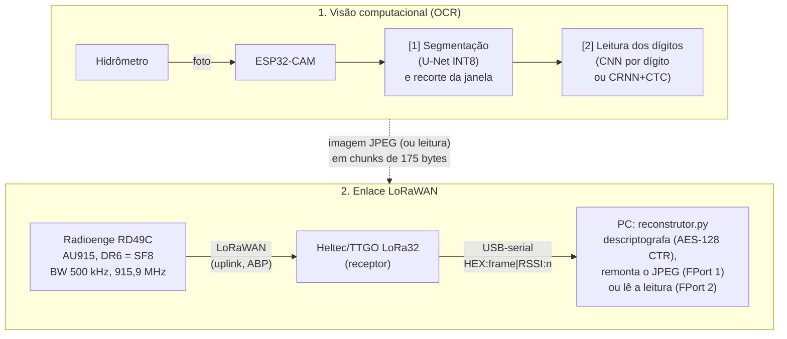

# Codigo-do-TCC2

Compilado de todos os códigos usados no TCC2: **leitura automática de hidrômetro com
ESP32-CAM e envio da imagem/leitura por LoRaWAN**.

O trabalho une duas frentes que se complementam:

1. **Visão computacional embarcada (OCR)** — a partir da foto de um hidrômetro de "rodinhas"
   (*word-wheel*), localizar a janela de dígitos e ler o valor (m³) com redes neurais pequenas
   o bastante para rodar em microcontrolador (TFLite Micro / INT8).
2. **Enlace LoRaWAN** — transportar a imagem (ou a leitura) da ESP32-CAM até um receptor
   usando um módulo Radioenge RD49C, no plano de canais AU915 e dentro das regras da Anatel.

---

## Sumário

- [Decisão: pipeline de OCR na borda](#decisão-pipeline-de-ocr-na-borda)
- [Origem das imagens e como o pipeline é avaliado](#origem-das-imagens-e-como-o-pipeline-é-avaliado)
- [Visão geral da arquitetura](#visão-geral-da-arquitetura)
- [Estrutura do repositório](#estrutura-do-repositório)
- [Como reproduzir](#como-reproduzir)
- [Hardware utilizado](#hardware-utilizado)
- [1. Rede LoRaWAN (`Rede/`)](#1-rede-lorawan-rede)
- [2. PoC de redução de imagem (`poc_diminuicao_imagem/`)](#2-poc-de-redução-de-imagem-poc_diminuicao_imagem)
- [3. OCR em PC, arquivado (`legado/ocr_cloud/`)](#3-ocr-em-pc-arquivado-legadoocr_cloud)
- [4. Pipeline A, arquivado (`legado/TreinoEModelosOCRNaBorda/`)](#4-pipeline-a-arquivado-legadotreinoemodelosocrnaborda)
- [5. Classificador de dígitos + dataset (`ModeloEDataset/`)](#5-classificador-de-dígitos--dataset-modeloedataset)
- [6. Firmware de debug/calibração (`test_images/`)](#6-firmware-de-debugcalibração-test_images)
- [Configuração de segredos](#configuração-de-segredos)
- [Datasets e créditos](#datasets-e-créditos)
- [Histórico de branches](#histórico-de-branches)
- [Limitações conhecidas e próximos passos](#limitações-conhecidas-e-próximos-passos)
- [Autores](#autores)

---

## Decisão: pipeline de OCR na borda

**Escolhido: Pipeline B** — [`ModeloEDataset/`](ModeloEDataset/README.md) (segmentação U-Net 192×192 INT8 +
classificador de dígito 28×28 INT8 sobre N fatias) com o firmware
[`test_images/debug_ocr_esp32cam/`](test_images/debug_ocr_esp32cam/README.md). Existiam três pipelines em
branches e pastas diferentes; os outros dois foram arquivados em [`legado/`](legado/README.md).

| Critério | B (`ModeloEDataset/`) | A (`legado/TreinoEModelosOCRNaBorda/`) | C (`legado/ocr_cloud/`) |
|---|---|---|---|
| Cabe no ESP32-CAM | **Sim.** Arenas de 1,62 MB (segmentação) e 28,6 KB (dígito), medidas; sobram 1,29 MB de PSRAM | **Não.** O detector pede 15.335.424 bytes de arena; havia 4.053.940 (teste em placa) | Não se aplica (só PC) |
| Roda em hardware | **Sim**, 61 capturas na ESP32-CAM | Não: a alocação falha; os leitores CTC também (operador `REDUCE_PROD` ausente na TFLM do core 3.0.7) | Não |
| Latência | ≈ 17,8 s por leitura (15,6 s de segmentação + 2,0 s de dígitos) | Não se aplica | Não se aplica |
| Acurácia | 95,4 % por dígito na validação por foto (INT8); 97,7 % dos dígitos (92,8 % das leituras) nas pastas `test` do Dryad; 91 % (29/32 dígitos) em imagens novas | Leitor CTC: 39 % a 64 % de acerto de sequência em recortes de máscara; no máximo 1 de 10 fotos de ponta a ponta | Treinado só com fontes de dígitos, não com hidrômetros |

Evidências: [`medicoes/README.md`](medicoes/README.md) (B em hardware),
[`medicoes/teste_pipeline_a_esp32cam.md`](medicoes/teste_pipeline_a_esp32cam.md) (A em hardware) e
[`ModeloEDataset/relatorios/`](ModeloEDataset/relatorios/RESULTADOS.md) (acurácia de B). O descarte de A vale
**para o modelo como exportado, na TFLM do core 3.0.7**: não prova que a ideia de CTC não funciona.

**Como B será usado: câmera fixa e janela calibrada na instalação.** O modelo de segmentação não localiza a
janela dos dígitos fora do enquadramento calibrado: no conjunto de teste comum (fotos do mostrador inteiro) ele
errou a caixa nas 39 fotos e não leu nenhuma. Como a câmera fica parada diante do medidor, a janela cai sempre na
mesma região do quadro; então, em vez de segmentar a cada leitura, a região (ROI) e a inclinação são **ajustadas
uma vez na instalação** e o classificador lê as N fatias dessa ROI. O que se mediu ([`ocr/README.md`](ocr/README.md)):
com a janela certa e o quadro endireitado, a leitura chega a 82–87 % das leituras e 92–95 % dos dígitos; a ROI
precisa de precisão de cerca de **±1 a ±2 px** no quadro 160×120 (com erro de ±4 px caem para 40–50 %, e com ±6 px
para 20–26 %). Consequência **estimada, não medida** (o firmware ainda não foi alterado): sem a segmentação, a
leitura dispensaria os ≈ 15,6 s dela e a arena de 1,6 MB, ficando nos ≈ 2 s do classificador.

**Limitações de B assumidas:**
- **Calibração da ROI**: a ROI e a inclinação precisam ser ajustadas na instalação com ±1 a ±2 px de precisão, e ainda
  não existe uma etapa ou ferramenta para isso (o firmware de debug serve para posicionar a câmera à mão).
- **Fatiamento calibrado à mão**: `N_FATIAS` (número de rodinhas) é ajustado por medidor; B não lê sozinho um
  medidor desconhecido.
- **Avaliação ainda fraca**: os 100 % de domínio são sobre as mesmas 24 fotos do *fine-tuning*, e a acurácia de
  leitura completa foi medida só por **emulação** em fotos de um monitor (`ocr/teste_comum/`), não em hardware nem
  em medidor físico (ver [Origem das imagens](#origem-das-imagens-e-como-o-pipeline-é-avaliado)).
- **Última rodinha**: é o dígito que mais erra (a rodinha gira); o classificador dá menos confiança nele, o que
  permite sinalizá-lo como duvidoso.

### Mapa de pastas e branches

O trabalho foi unificado na `main`; as branches `ocr` e `Treino-Testes-e-Modelos` ficam como histórico.

| Pasta | Papel | Situação | Branch de origem |
|---|---|---|---|
| `ModeloEDataset/` | Pipeline B: treino do classificador e da segmentação | **Escolhido** (borda) | `ocr` |
| `test_images/debug_ocr_esp32cam/` | Firmware de B na ESP32-CAM | **Escolhido** (borda) | `ocr` |
| `legado/TreinoEModelosOCRNaBorda/` | Pipeline A (U-Net 384×384 + CRNN/CTC) | Arquivado | `Treino-Testes-e-Modelos` |
| `legado/ocr_cloud/` | Pipeline C (U-Net de A + CNN 68×68, no PC) | Arquivado | `main` |
| `ocr/colab_poc/` | Teste de viabilidade: um OCR genérico (Tesseract/EasyOCR) lê uma imagem 160×120. **Não será usado no trabalho** | Concluído (uma foto de entrada versionada) | `main` |
| `ocr/pipeline_nuvem.py`, `ocr/avaliar.py` | Lado da nuvem: **os mesmos modelos de B** rodando no servidor sobre o JPEG remontado; avaliação borda × nuvem | Implementado ([`ocr/README.md`](ocr/README.md)) | — |
| `ocr/teste_comum/` | Conjunto de teste comum: 39 fotos, 19 leituras, com gabarito conferido | Primeira versão | — |

---

## Origem das imagens e como o pipeline é avaliado

**Nenhuma foto do repositório é de um hidrômetro físico.** As fotos da ESP32-CAM são de um **monitor** exibindo
imagens de hidrômetro (por exemplo, `ModeloEDataset/Imagens/imagem_capturada_15.jpg` mostra a tela e
`ModeloEDataset/Imagens_2/Imagens_teste_2_ESP32/imagem_capturada_144.jpg` mostra a barra de tarefas). Isso testa a
câmera, a lente e a compressão, mas **não** o reflexo, a iluminação e o ângulo de um medidor de verdade.

| Onde | Fotos | Origem | Usada como |
|---|---|---|---|
| `ModeloEDataset/Imagens/` | 34 | ESP32-CAM, **monitor** | 3 delas (24 recortes de dígito) no *fine-tuning* do classificador; as outras não entram no treino |
| `ModeloEDataset/Imagens_2/Imagens_teste_2_ESP32/` | 2 | ESP32-CAM, **monitor** | teste do classificador com recorte manual |
| `ModeloEDataset/Imagens_2/Imagens_teste_2/` | 4 | fotos de datasets públicos (ex. `20221221_01143.jpg`) | teste do classificador com recorte manual; **nenhuma coincide byte a byte com os 109.018 arquivos do Dryad** (os nomes do Dryad são `testN.jpg`/`trainN.jpg`, então o padrão de nome não prova nada); independência por conteúdo (mesmo medidor em outra foto) não foi verificada |
| `ocr/teste_comum/imagens/` | 39 | ESP32-CAM, **monitor** | pipeline completo, borda × nuvem (`ocr/avaliar.py`, `ocr/avaliar_pipeline.py --conjunto comum`) |
| `test_images/debug_ocr_esp32cam/debug_frames/` | frames | ESP32-CAM, origem (monitor ou físico) **não registrada** | conferência do firmware de debug |
| `legado/TreinoEModelosOCRNaBorda/dataset/imagens_reais/` | 14 | imagens avulsas, não da ESP32-CAM (nas que foram conferidas: `image1.jpg` é uma foto de catálogo e `image9.jpg`, uma figura explicativa) | pipeline A, arquivado |
| Kaggle (Yandex.Toloka) | 1.244 | fotos de medidores, não versionadas | treino da segmentação (`pipeline.py`) e 195 imagens para o classificador |
| Dryad, pastas `train` | — | recortes 200×60, não versionados | treino do classificador |
| Dryad, pastas `test` | — | idem | **fora do treino** (`preparar_dataset_dryad.py` não as usa mais); teste do classificador em `ocr/avaliar_teste_publico.py` |

**Como o pipeline é avaliado agora.** [`ocr/avaliar_pipeline.py`](ocr/avaliar_pipeline.py) roda o pipeline completo em
INT8 (caixa prevista pelo **modelo de segmentação** → fatias iguais → classificador de dígito, sem caixa manual) nos
dois fluxos, borda (quadro 160×120 direto) e nuvem (o mesmo quadro depois do JPEG q90), e grava em
[`medicoes/ocr_teste.csv`](medicoes/ocr_teste.csv): taxa de leitura exata, acurácia por dígito, CER, Dice/IoU da

---

## Visão geral da arquitetura



Os dois estágios de OCR já foram **testados juntos em uma ESP32-CAM real**
(ver [`test_images/`](test_images/debug_ocr_esp32cam/README.md)). O enlace LoRaWAN foi validado
separadamente transmitindo a imagem em chunks (ver [`Rede/`](#1-rede-lorawan-rede)). A integração
final (OCR no dispositivo → só a leitura trafega por LoRaWAN) tem firmware,
[`Rede/transmissor_ocr_esp32cam/`](Rede/transmissor_ocr_esp32cam/transmissor_ocr_esp32cam.ino), e
leitura no PC (FPort 2, `medicoes/transmissao_ocr.csv`), mas **ainda não foi compilado com a toolchain do
ESP32 nem testado em placa**; a parte do PC foi testada só com frames sintéticos.

---

## Estrutura do repositório

```
Codigo-do-TCC2/
├── Rede/                          Firmwares do enlace LoRaWAN (Arduino IDE)
│   ├── transmissor_esp32cam/      Transmissor do fluxo de IMAGEM (FPort 1): câmera (CAPTURE), reenvio (RESEND), envio vindo do PC (SEND), teste de enlace (SENDALL) e modo autônomo com deep sleep (AUTO/STOP/SLEEP; testado em placa, com consumo e latência ponta a ponta medidos em 30 ciclos). No modo autônomo desliga a câmera após a captura
│   ├── transmissor_ocr_esp32cam/  Transmissor do fluxo de OCR NA BORDA (FPort 2): captura, lê os dígitos na ESP32-CAM (segmentação + classificador, TFLite Micro) e envia só a leitura (9 bytes) em um uplink; mesmo deep sleep e mesma linha [CICLO_FIM]. Contém cópias de `modelo.h`/`modelo_digito.h`. Compila com o core 3.0.7 (arduino-cli, 563 KB, 17% da flash) e roda em placa (consumo medido em 30 ciclos e latência ponta a ponta em 34 disparos)
│   ├── receptor_lora32/           Firmware do receptor (Heltec/TTGO LoRa32)
│   └── requirements.txt           Igual ao requirements.txt da raiz
├── legado/                        Fora do fluxo atual (ver legado/README.md): protótipo serial → ChirpStack e os pipelines de OCR arquivados (`ocr_cloud/` = C, `TreinoEModelosOCRNaBorda/` = A)
├── dados/teste/                   Conjunto de teste de hidrômetro FÍSICO (21 fotos rotuladas da ESP32-CAM; ver dados/teste/README.md)
├── ocr/                           Lado da nuvem (modelos de B no servidor), avaliação borda × nuvem e conjunto de teste comum (ver ocr/README.md)
│   └── colab_poc/                 Teste de viabilidade de OCR genérico em imagem 160×120 (Tesseract/EasyOCR no Colab; não será usado no trabalho)
├── enlace.py                      PC: parâmetros do enlace (bloco, cabeçalho), parser LoRaWAN e parser da leitura OCR (FPort 2) compartilhados
├── registro.py                    PC: registro das medições (logs completos + medicoes/transmissao.csv e medicoes/transmissao_ocr.csv); usado pelos dois scripts abaixo
├── reconstrutor.py                PC: lê a serial do receptor, descriptografa, remonta o JPEG (FPort 1) ou lê a leitura OCR (FPort 2) e registra PDR, tempo de rádio e latência (`--tx` controla o nó; `--fluxo ocr` manda `LER` no lugar de `CAPTURE`)
├── decode_lorawan.py              PC: decodifica/descriptografa uplinks e mostra quais chunks faltam
├── orchestrator.py                PC: envia a imagem em chunks (SEND:), confere o recebimento, reenvia o que faltou e registra a medição
├── analise_tempo_no_ar.py         PC: calcula pacotes, tempo no ar e tempo total de envio (`--verificar` confere a fórmula)
├── medicoes/                      Medições em hardware: `transmissao.csv` (fluxo de imagem), `transmissao_ocr.csv` (fluxo OCR) + `logs/` + `imagens/` do enlace (ver medicoes/medir_transmissao.md) e as de OCR/energia/latência
├── config.py, .env.example        Leitura do .env e modelo das variáveis (chaves, rede, portas)
├── requirements.txt               Dependências dos scripts da raiz (pyserial, pycryptodome)
├── scripts/download_datasets.py   Baixa os datasets públicos (eles não ficam no Git)
├── poc_diminuicao_imagem/         PoC em C++/OpenCV: redução/binarização de imagem p/ caber no LoRa
├── ModeloEDataset/                **Pipeline B (OCR de borda escolhido)**: segmentação + classificador de dígitos (CNN) + datasets + relatórios
├── test_images/                   Fotos da ESP32-CAM + firmware de debug/calibração com OCR on-device (Pipeline B)
├── image.jpg, imagem_recebida.jpg, imagem_parcial.jpg
│                                  Imagem de teste do `orchestrator.py` e saídas de execuções antigas (hoje as imagens vão para `medicoes/imagens/`)
└── README.md
```

> **Atenção ao enlace:** há dois transmissores, um por fluxo, e eles falam em portas LoRaWAN diferentes.
> O de imagem, [`Rede/transmissor_esp32cam/`](Rede/transmissor_esp32cam/transmissor_esp32cam.ino) (FPort 1),
> usa o cabeçalho binário de 6 bytes (id da leitura + índice base 0 + total). O de OCR,
> [`Rede/transmissor_ocr_esp32cam/`](Rede/transmissor_ocr_esp32cam/transmissor_ocr_esp32cam.ino) (FPort 2),
> manda um payload de `3 + N` bytes (id, flags e os N dígitos em ASCII; ver [Fluxo OCR](#fluxo-ocr-na-borda-fport-2)).
> Os scripts do PC (`reconstrutor.py`, `decode_lorawan.py`, `orchestrator.py`) usam os mesmos formatos e o mesmo
> tamanho de bloco, definidos em [`enlace.py`](enlace.py). Se mudar o `CHUNK_DATA_SIZE` do firmware de imagem,
> mude também o de `enlace.py`; se mudar o payload da FPort 2, mude `parse_leitura` e `montar_payload_leitura`.
> O `decode_lorawan.py` e o `orchestrator.py` ainda tratam só o fluxo de imagem.

> Cada pasta de OCR tem uma abordagem própria (ver tabela abaixo). Elas **não dependem umas das
> outras** — cada uma tem seu próprio dataset, `requirements.txt` e scripts. A escolhida para o trabalho é a
> `ModeloEDataset/` (ver [Decisão](#decisão-pipeline-de-ocr-na-borda)); as outras ficam em `legado/`.

| Pasta | Abordagem de leitura | Segmentação | Onde roda |
|---|---|---|---|
| `legado/ocr_cloud/` (arquivado) | CNN de 1 caractere (68×68) sobre 6 recortes iguais; há também teste com CRNN+CTC | U-Net INT8 384×384 | PC |
| `legado/TreinoEModelosOCRNaBorda/` (arquivado, A) | **CRNN + CTC** (visor inteiro 48×224, classe *blank* = 10), float e QAT | U-Net com QAT, 384×384 | Só PC: não cabe na ESP32-CAM |
| `ModeloEDataset/` (**escolhido**, B) | CNN de dígito (28×28, 72 mil parâmetros) sobre N fatias | U-Net INT8 192×192 (`modelo_esp32.tflite`) | Treino no PC → ESP32-CAM (testado em placa) |

---

## Como reproduzir

### Python e dependências por pasta

Cada pasta tem seu próprio ambiente (`.venv` + `requirements.txt`). Não instale tudo no mesmo venv.
Os comandos abaixo usam a sintaxe do Windows (`.venv\Scripts\...`); no Linux/WSL troque por
`.venv/bin/...`.

| Pasta | Python | Dependências | O que foi verificado |
|---|---|---|---|
| Raiz (scripts do enlace) e `Rede/` | 3.9 ou superior | `requirements.txt` (pyserial, pycryptodome; igual ao de `Rede/`) | Rodado com 3.13.9 |
| `legado/` (protótipo antigo) | 3.9 ou superior | `legado/requirements.txt` (pyserial, paho-mqtt) | `decode.py` rodado com 3.13.9 (CRC confere) |
| `legado/ocr_cloud/` | **3.13** | `legado/ocr_cloud/requirements.txt` (TensorFlow 2.21.0, Keras 3.15.1) | Instalado em venv limpo (3.13.9) e `modelo_ocr.keras` carregado com sucesso |
| `legado/TreinoEModelosOCRNaBorda/` | **Linux / WSL2** (GPU opcional) | `requirements.txt` da pasta: é um `pip freeze` com pacotes NVIDIA/CUDA que não têm wheel para Windows (TensorFlow 2.21.0, Keras 3.15.1, tf_keras 2.21.0) | Python **3.11 a 3.13**: a resolução dos wheels Linux x86_64 foi conferida nas três versões; o treino em si não foi reexecutado |
| `ModeloEDataset/` | **3.10** (TensorFlow 2.16.1 só tem wheels até 3.12) | `ModeloEDataset/requirements.txt` | Instalado em venv limpo com Python 3.10.11 (versões fixadas, `pip check` sem erros); modelo `.h5` e `.tflite` carregados |
| `poc_diminuicao_imagem/` | — | g++, OpenCV 4 e Qt6 em `/usr/include` (Linux/WSL, ver `makefile`) | — |
| Firmwares `.ino` | — | Arduino IDE + core ESP32; biblioteca **LoRa** (Sandeep Mistry); para o firmware de debug, uma biblioteca de TensorFlow Lite Micro | Não compilados nesta revisão |

### Passo a passo

**1. Clonar e configurar o `.env`** (chaves, rede e portas; veja [Configuração de segredos](#configuração-de-segredos)):

```bash
git clone https://github.com/Marcelo-122/Codigo-do-TCC2.git
cd Codigo-do-TCC2
copy .env.example .env      # Linux/macOS: cp .env.example .env
```

**2. Baixar os datasets** (só é necessário para treinar; a inferência usa os modelos e as fotos
versionados). Os datasets públicos **não ficam no Git**:

```bash
pip install kaggle          # e defina KAGGLE_API_TOKEN (token em kaggle.com/settings/api) no ambiente ou no .env
python scripts/download_datasets.py --listar    # fontes e licenças
python scripts/download_datasets.py             # baixa os do Kaggle
```

| Pasta | Precisa de | Onde fica |
|---|---|---|
| `legado/ocr_cloud/` (treino) | Digits 0–9 | `legado/ocr_cloud/num_dataset/` |
| `legado/TreinoEModelosOCRNaBorda/` | Yandex.Toloka + Digits 0–9 | `dataset/images/`, `dataset/masks/`, `dataset/num/`; depois `gerar_blackout.py` e `gerador_sintetico.py` criam `visores_blackout/` e `visores_sinteticos/` |
| `ModeloEDataset/` | Yandex.Toloka + Word-Wheel (Dryad, **download manual**, 2,8 GB) | `dataset/images/`, `dataset/masks/`, `dataset/Word-Wheel_Water_Meter_Dataset/`. As fotos de cartaz do TCC I não estão no repo: use `--cartaz PASTA` em `preparar_dataset_dominio_esp32.py` |

**3. Rodar cada parte** (detalhes nas seções abaixo):

| Objetivo | Comandos |
|---|---|
| Receber e remontar a imagem (enlace) | `python -m venv .venv`, `.venv\Scripts\pip install -r requirements.txt`, `.venv\Scripts\python reconstrutor.py`; veja [seção 1](#1-rede-lorawan-rede) |
| OCR no PC, só inferência | `cd legado\ocr_cloud`, venv + `pip install -r requirements.txt`, `python src\test_model_ocr_cloud_poc.py` ([seção 3](#3-ocr-em-pc-arquivado-legadoocr_cloud)) |
| Treinar o OCR do `legado/ocr_cloud` | mesmo venv, depois do passo 2: `python src\train_model_ocr_cloud.py` |
| Treinar detector e leitor CRNN+CTC | em WSL/Linux, `cd legado/TreinoEModelosOCRNaBorda`, depois do passo 2 ([seção 4](#4-pipeline-a-arquivado-legadotreinoemodelosocrnaborda)) |
| Treinar o classificador de dígitos | `cd ModeloEDataset`, Python 3.10, depois do passo 2 ([seção 5](#5-classificador-de-dígitos--dataset-modeloedataset)) |

---

## Hardware utilizado

| Peça | Função |
|---|---|
| **ESP32-CAM (AI-Thinker)** | Captura a imagem (QQVGA 160×120 em escala de cinza, convertida para JPEG qualidade 90) e, no `debug_ocr_esp32cam` e no `transmissor_ocr_esp32cam`, roda o OCR |
| **Radioenge RD49C** | Módulo LoRaWAN (comandos `AT+...`), ligado à ESP32-CAM por UART (RX = GPIO 15, TX = GPIO 14) |
| **Heltec / TTGO LoRa32 V2** | Receptor LoRa: SS = 18, RST = 14, DIO0 = 26; imprime os frames recebidos na serial |
| **PC** | Roda `reconstrutor.py` (remonta a imagem e registra as medições) e treina os modelos |

### Parâmetros do enlace (tabela única)

Todos os componentes (Radioenge, transmissor, receptor, scripts do PC) usam estes valores.

| Parâmetro | Valor | Onde é definido / fonte |
|---|---|---|
| **Plano de canais** | AU915 (915–928 MHz) | Manual Radioenge (RD49C); Ato 14.448, item 10.1 |
| **Canal** | **Fixo, 500 kHz, 915,9 MHz**: canal 64 na numeração do RP002 (base 0) = canal 65 na do manual Radioenge (base 1) | `receptor_lora32.ino` (`FREQ_HZ`) |
| **Máscara de canais** | `AT+CHMASK=0000:0000:0000:0000:0001:0000` | Manual, seção 5.2.15 |
| **Datarate** | **DR6 = SF8 / BW 500 kHz**, `AT+DR=6` com `AT+ADR=0` (o `AT+DR` só vale com o ADR desligado) | Manual, Tabelas 7 e 5.2.2; `receptor_lora32.ino` |
| **Camada física** | Código 4/5, preâmbulo de 8 símbolos, CRC ligado, cabeçalho explícito, sync word `0x34` | Padrão LoRaWAN; `receptor_lora32.ino` |
| **Ativação / porta** | ABP. FPort 1 para os chunks de imagem (`AT+SENDB=01:<hex>`) e **FPort 2** para a leitura do OCR (`AT+SENDB=02:<hex>`) | `transmissor_esp32cam.ino`, `transmissor_ocr_esp32cam.ino`; `FPORT` e `FPORT_LEITURA` em `enlace.py` |
| **Potência** | Máx. +20 dBm (100 mW), fixa no módulo (não há comando `AT` para mudar) | Manual, especificações |
| **Payload máximo (DR6)** | 222 B | Manual, Tabela 8 |
| **Bloco de imagem por pacote** | **175 B** de dados + 6 B de cabeçalho = **181 B** de payload (41 B de folga) | `CHUNK_DATA_SIZE` no `.ino` e em `enlace.py` |
| **Cabeçalho do chunk** | `uint16` id da leitura (sorteado a cada `CAPTURE`) + `uint16` índice (base 0) + `uint16` total, big-endian | `enlace.py` |
| **Payload da leitura OCR (FPort 2)** | `uint16` id da leitura + `uint8` flags (bit 7 = caixa achada, bits 0–6 = nº de dígitos N) + N dígitos em ASCII (`0`–`9`, `?` = fatia não classificada, `-` = sem caixa). Com N = 6: **9 B** de payload, um uplink por leitura | `parse_leitura` / `montar_payload_leitura` em `enlace.py`; `enviarLeitura` no `.ino` |
| **Intervalo entre pacotes** | 7 s | `SEND_INTERVAL_MS` no `.ino`; `orchestrator.py` |
| **Captura** | QQVGA 160×120, escala de cinza, convertida em JPEG qualidade 90 (`fmt2jpg`, escala 1–100) | `JPEG_QUALITY` no `.ino` |
| **Tamanho do JPEG** | Medido: 2.460 a 4.209 B (média 3.640 B, 4 capturas). **Referência de projeto: 4.300 B** | `analise_tempo_no_ar.py` |

**Tempo no ar** (SF8 / 500 kHz, bloco de 175 B, imagem de referência de 4.300 B), calculado por
[`analise_tempo_no_ar.py`](analise_tempo_no_ar.py) com a fórmula da Semtech (AN1200.13):

| Grandeza | Valor |
|---|---|
| Pacotes | 25 |
| Tempo no ar por pacote (194 B na camada física) | 135,8 ms |
| **Tempo total de rádio** | **3,35 s** |
| Tempo total de envio (com intervalo de 7 s) | ≈ 168 s |

Para outros tamanhos de imagem ou bloco: `python analise_tempo_no_ar.py --imagem 3000 --bloco 175`.
`--verificar` confere a fórmula com um valor de referência externo.

**Enquadramento na regulamentação (Ato Anatel nº 14.448/2017, item 10.3):** sistemas de modulação
digital precisam de largura de faixa a 6 dB ≥ 500 kHz (10.3.1), potência de pico ≤ 1 W (10.3.2) e
densidade espectral ≤ 8 dBm em 3 kHz (10.3.3). Com +20 dBm espalhados em 500 kHz, a densidade fica
em torno de −2 dBm em 3 kHz (estimativa que supõe espectro plano). Esse enquadramento dispensa o
salto de frequência e o limite de ocupação por canal do item 10.2. A largura a 6 dB do LoRa de
500 kHz nominais deve ser confirmada pela homologação do módulo, e antenas com ganho acima de
6 dBi exigem reduzir a potência (item 10.5). A alternativa com salto de frequência (item 10.2.5.2,
35 canais de 125 kHz, `AT+DR=5`) também seria válida, mas não é a usada aqui.

> Atenção: **nunca** use `CHMASK` com menos de 35 canais em BW = 125 kHz: não se enquadra em
> nenhum dos dois itens da regulamentação.

---

## 1. Rede LoRaWAN (`Rede/`)

### Fluxo

1. A ESP32-CAM (firmware em [`Rede/transmissor_esp32cam/`](Rede/transmissor_esp32cam/transmissor_esp32cam.ino)) recebe `CAPTURE` pela serial, tira uma foto JPEG e a divide em **chunks de 175 bytes**.
2. Cada chunk vai com um cabeçalho binário de 6 bytes — `uint16 id` (da leitura) + `uint16 index` +
   `uint16 total` (big-endian) — e é enviado ao Radioenge com `AT+SENDB=01:<hex>` (FPort 1).
3. O **receptor LoRa32** escuta em 915,9 MHz / SF8 / BW 500 kHz e escreve na serial uma linha por
   frame: `HEX:<bytes do frame>|RSSI:<valor>`.
4. O **`reconstrutor.py`** lê essas linhas, extrai o `FRMPayload`, **descriptografa com a AppSKey**
   (AES-128 em modo CTR, conforme a especificação LoRaWAN), junta os chunks e grava a imagem em
   `medicoes/imagens/` (chunks faltantes geram um arquivo `_parcial.jpg`, com zeros nos buracos).
   Para completar, mande `RESEND:<índices base 0>` no transmissor **com o script ainda rodando**: o
   `RESEND` reenvia a mesma foto. Não use `CAPTURE` para isso, porque ele tira outra foto.
5. Cada leitura vira uma linha em `medicoes/transmissao.csv` (PDR, tempo de rádio, latência...) e
   cada execução deixa logs completos em `medicoes/logs/<execução>/`. Veja
   [`medicoes/medir_transmissao.md`](medicoes/medir_transmissao.md).

### Fluxo OCR na borda (FPort 2)

No fluxo de OCR na borda o dispositivo lê o medidor e só a **leitura** trafega, em um único uplink:

1. A ESP32-CAM (firmware em [`Rede/transmissor_ocr_esp32cam/`](Rede/transmissor_ocr_esp32cam/transmissor_ocr_esp32cam.ino))
   captura o quadro 160×120, copia-o, **desliga a câmera**, roda a segmentação e o classificador de dígito
   (os mesmos modelos do `debug_ocr_esp32cam`; a segmentação ainda roda a cada leitura, ~15,6 s) e monta o payload.
2. O payload vai ao Radioenge com `AT+SENDB=02:<hex>` (**FPort 2**): `uint16` id + `uint8` flags + N dígitos em ASCII
   (9 bytes com N = 6). Não há blocos nem JPEG: um uplink por leitura, e o ciclo ativo cai de ~140 s (18 chunks a 7 s)
   para algo na ordem da inferência (~18 s), a confirmar na medição.
3. O `reconstrutor.py` descriptografa como sempre e, ao ver FPort 2, decodifica a leitura com
   `enlace.parse_leitura()`. Cada leitura vira uma linha em **`medicoes/transmissao_ocr.csv`**, separada do
   `transmissao.csv` de imagem (as duas coexistem na mesma execução).
4. O PDR do enlace sai das lacunas de FCnt (cada ciclo é um uplink); a latência só existe com o nó ligado ao PC
   (`--tx --fluxo ocr`, que manda `LER`) ou com o `latencia_ponta_a_ponta.py ... --fluxo ocr`.

O transmissor de OCR repete o deep sleep e a linha `[CICLO_FIM]` do de imagem (com os tempos de cada etapa:
`t_captura_ms`, `t_modelos_ms`, `t_seg_ms`, `t_digitos_ms`, `t_envio_ms`), para o consumo dos dois fluxos ser medido e
comparado com os mesmos scripts. **Estado:** o firmware só passou por checagem de sintaxe com stubs, e o lado do PC foi
testado com frames sintéticos; nada disso rodou com as placas.

### Firmwares (Arduino IDE)

| Sketch | Placa | Observações |
|---|---|---|
| `Rede/transmissor_esp32cam/` | AI Thinker ESP32-CAM | **Transmissor do fluxo de imagem (FPort 1).** Comandos pela serial: `CAPTURE` (captura e envia), `RESEND:2,7,15` (reenvia chunks da última captura), `SEND:<id>:<índice>:<total>:<hex>` (dados vindos do PC, usado pelo `orchestrator.py`), `SENDALL:<n>` (teste de enlace sem câmera, payload fixo), `AUTO[:<s>]`/`STOP`/`SLEEP:<s>` (modo autônomo com deep sleep) ou `AT...` (repassado ao Radioenge). Retentativas quando o módulo está ocupado. Intervalo entre chunks: `SEND_INTERVAL_MS` (7000 ms). |
| `Rede/transmissor_ocr_esp32cam/` | AI Thinker ESP32-CAM, PSRAM habilitada | **Transmissor do fluxo de OCR na borda (FPort 2).** Comandos: `LER` (lê o medidor e envia a leitura), `AUTO[:<s>]`/`STOP`/`SLEEP:<s>` (mesmos do outro) e `AT...`. Precisa da biblioteca TensorFlow Lite Micro e dos modelos `modelo.h`/`modelo_digito.h`, que são **cópias** das de `test_images/debug_ocr_esp32cam/` (copie de novo se retreinar). Imprime `[ocr] leitura=...`, `[ocr] enviando leitura id N` e `[CICLO_FIM]`, que o PC lê. |
| `Rede/receptor_lora32/` | TTGO/Heltec LoRa32 V2 | Biblioteca **LoRa** (Sandeep Mistry). Frequência fixa 915,9 MHz. Serve aos dois fluxos (repassa o frame, qualquer FPort). |

### Rodando o receptor no PC

Na raiz do repositório (o `reconstrutor.py`, o `config.py` e o `requirements.txt` ficam lá):

```bash
python -m venv .venv
# Windows
.venv\Scripts\pip install -r requirements.txt
# Preencha o .env com as chaves e RX_SERIAL_PORT (ver "Configuração de segredos")
.venv\Scripts\python reconstrutor.py
# Em outro terminal serial (ou no Monitor Serial do transmissor) envie:  CAPTURE
```

Para **medir** (a issue pede ≥ 30 envios a distâncias fixas), deixe o PC controlar o nó também:
feche o Monitor Serial e rode, por exemplo,

```bash
.venv\Scripts\python reconstrutor.py --tx --envios 30 --distancia 50
```

Isso manda `CAPTURE` 30 vezes, lê o log do nó e do receptor com um único relógio e grava tudo em
`medicoes/`. Definições das colunas, o que cada log guarda e limitações em
[`medicoes/medir_transmissao.md`](medicoes/medir_transmissao.md).

Com o nó rodando o `transmissor_ocr_esp32cam`, use `--fluxo ocr`: o PC manda `LER` no lugar de `CAPTURE` e
espera o uplink da FPort 2 (timeout de resposta do nó de 90 s). O resultado vai para `medicoes/transmissao_ocr.csv`:

```bash
.venv\Scripts\python reconstrutor.py --tx --fluxo ocr --envios 30 --distancia 50
```

Sem `--tx`, o `reconstrutor.py` só escuta e aceita os dois fluxos (por exemplo, com o nó em `AUTO`).

Para enviar uma imagem do PC pelo transmissor de teste (`Rede/transmissor_esp32cam/`), com o `.env`
preenchido (`TX_SERIAL_PORT`, `RX_SERIAL_PORT`, chaves e `IMAGE_PATH`); também registra a medição:

```bash
.venv\Scripts\python orchestrator.py --distancia 50
```

### Protótipo anterior ([`legado/`](legado/README.md))

Primeira abordagem, **sem rádio real**: a ESP32-CAM mandava os chunks por USB-serial e o PC os
injetava num servidor ChirpStack. O ChirpStack só servia como simulador de teste e **saiu do
trabalho**; o fluxo atual não usa servidor de rede. Os scripts, o sketch e as capturas de exemplo
desse protótipo ficam em [`legado/`](legado/README.md). O `mac_simulator.py` (simulador de gateway
via Semtech UDP, `868.1` MHz / `SF7BW125`) já havia sido removido: o fluxo final usa o enlace real em
AU915 / DR6 / 500 kHz.

---

## 2. PoC de redução de imagem (`poc_diminuicao_imagem/`)

Prova de conceito em **C++ / OpenCV** para medir quanto uma imagem encolhe ao ser convertida para
tons de cinza e binarizada (`Cinza.png`, `Binaria.png`) — relevante porque cada byte a menos
significa menos chunks no enlace LoRa. O programa varre `imagens/`, imprime largura, altura,
canais e tamanho em bytes de cada etapa e grava o resumo em `output.txt`.

```bash
cd poc_diminuicao_imagem
# Requer g++, OpenCV 4 e Qt6 (ajuste os caminhos do makefile para o seu sistema)
make
```

---

## 3. OCR em PC, arquivado (`legado/ocr_cloud/`)

> **Arquivado.** Não é o pipeline de borda do trabalho:
> é a U-Net de `legado/TreinoEModelosOCRNaBorda/` mais uma CNN de dígito treinada em fontes de dígitos, não em
> hidrômetros. Fica em `legado/` como registro.

Pipeline em Python/TensorFlow que roda no PC, pensado como alternativa quando o dispositivo apenas
envia a foto:

```
foto ──▶ modelo_medidor.tflite (segmentação, INT8, 384×384) ──▶ recorte da janela
       ──▶ divide em 6 pedaços iguais ──▶ modelo_ocr.keras (CNN de 1 dígito, 68×68) ──▶ "leitura"
```

| Item | Descrição |
|---|---|
| `src/train_model_ocr_cloud.py` | Treina a CNN de 1 caractere (3 × Conv2D + Dense, 10 classes) com `num_dataset/` e salva `models/modelo_ocr.keras` |
| `src/test_model_ocr_cloud_poc.py` | Executa segmentação + OCR por fatias nas fotos de `metering_dataset/` |
| `src/test_model_ocr_cloud_gustavo.py` | Variante que usa o modelo CRNN+CTC float (entrada 48×224, *blank* = 10) |
| `models/` | `modelo_medidor.tflite`, `modelo_ocr.keras`, `modelo_digitos_float_ctc_sint.tflite` |
| `metering_dataset/` | Fotos reais de hidrômetros para teste |
| `num_dataset/` | Dígitos isolados 0–9 (uma pasta por classe). **Não versionado:** baixe com `scripts/download_datasets.py` |
| `output_dataset/` | Saída da inferência (gerada, não versionada) |

Python **3.13** (testado em venv limpo: instala e carrega `modelo_ocr.keras`).

```bash
cd legado/ocr_cloud
python -m venv .venv && .venv\Scripts\pip install -r requirements.txt
.venv\Scripts\python src\test_model_ocr_cloud_poc.py     # inferência (usa models/ e metering_dataset/, ambos versionados)
.venv\Scripts\python src\train_model_ocr_cloud.py        # treino (antes: python ..\..\scripts\download_datasets.py --somente digitos)
```

---

## 4. Pipeline A, arquivado (`legado/TreinoEModelosOCRNaBorda/`)

> **Arquivado.** Não é o OCR de borda do trabalho: o teste em placa
> ([`medicoes/teste_pipeline_a_esp32cam.md`](medicoes/teste_pipeline_a_esp32cam.md)) mostrou que o detector
> pede 15,3 MB de arena (PSRAM de 4 MB) e que os leitores CTC usam um operador (`REDUCE_PROD`) ausente na
> TFLM do core 3.0.7. Fica como registro e como base de trabalho futuro (leitor CTC sem o `Tensordot`).

Treino dos dois modelos pensados para o microcontrolador, com **quantização consciente do
treino (QAT)** para INT8:

1. **Detector** (`treinamento-detector.py`): U-Net (entrada 384×384, 1 canal) com perda
   BCE + Dice; fase 1 treina em float, fase 2 faz *fine-tuning* com QAT e exporta
   `Modelos/modelo_medidor.tflite`.
2. **Leitor** (`treinamento-digitos-ctc.py`): rede convolucional + camadas temporais 1D (sem LSTM,
   para caber no MCU) treinada com **CTC** para ler o visor inteiro de uma vez. Treina em imagens
   reais "blackout" e em visores sintéticos; exporta versões float e QAT (`modelo_digitos_*_ctc*.tflite`).

| Script | Para que serve |
|---|---|
| `gerar_blackout.py` | Recorta e endireita o visor usando a máscara e apaga o fundo (`dataset/visores_blackout/`) |
| `gerador_sintetico.py` | Gera 1500 visores sintéticos colando dígitos isolados (`dataset/visores_sinteticos/`) |
| `treinamento-detector.py` / `treinamento-digitos-ctc.py` | Treino dos dois modelos |
| `diagnostico_detector.py` / `diagnostico_colapso_ctc.py` | Diagnósticos: IoU/Dice do detector; colapso do CTC e posição dos erros (Levenshtein) |
| `simulador_extracao_dual.py` | Roda detector + leitor sobre `dataset/imagens_reais/` e grava `CSVs/leituras_finais.*` |
| `BDM.py` | Valida o modelo QAT (IoU, Dice, latência) em amostras do dataset, do conjunto de teste e do "mundo real" → `CSVs/tabela_provas_funcionamento.csv` |
| `BDMwsl.cpp` | Teste do `.h` do modelo em **TFLite Micro** compilado no WSL/Linux (arena de 25 MB) |
| `Modelos/gerar_header.py` | Converte `.tflite` em header C (`modelo_medidor.h`) para o firmware |
| `CSVs/`, `resultados_visuais/`, `ModeloBrutoAntigoParaTeste/` | Históricos de treino/validação, imagens de diagnóstico e modelos antigos |
| `Backups/` | Checkpoints intermediários: **não versionados** (ficam só na máquina de quem treina) |

Os datasets (`dataset/images`, `masks`, `num`) **não ficam no Git**: baixe com
`python scripts/download_datasets.py` na raiz. Já `dataset/imagens_reais/` (fotos próprias) é
versionado. Ambiente: **WSL2/Linux** (o `requirements.txt` é um `pip freeze` com pacotes CUDA/NVIDIA,
sem wheel para Windows).

```bash
cd legado/TreinoEModelosOCRNaBorda
python -m venv .venv && source .venv/bin/activate && pip install -r requirements.txt   # WSL/Linux
python gerar_blackout.py
python gerador_sintetico.py
python treinamento-detector.py
python treinamento-digitos-ctc.py
python simulador_extracao_dual.py
python Modelos\gerar_header.py
```

> Os scripts usam `TF_USE_LEGACY_KERAS=1` (necessário para o `tensorflow_model_optimization`).

---

## 5. Classificador de dígitos + dataset (`ModeloEDataset/`)

> **Pipeline escolhido** para o OCR de borda (ver [Decisão](#decisão-pipeline-de-ocr-na-borda)).

Segundo estágio do OCR: um **classificador de dígito (0–9)** pequeno (72.442 parâmetros, 81,5 KB em
INT8) que lê cada fatia da janela de dígitos. Combina três fontes de dados (Kaggle, Dryad e fotos
reais da própria ESP32-CAM) e é treinado em duas fases (treino principal + *fine-tuning* de domínio).

| Métrica | Valor |
|---|---|
| Acurácia (validação por foto, INT8, 10 classes) | **95,4 %** |
| Pastas `test` do Dryad (fora do treino): leitura exata / dígitos | **92,8 % / 97,7 %** |
| Fotos reais da ESP32-CAM (24 recortes — mesmas do *fine-tuning*, número otimista) | 100 % |
| Imagens totalmente novas (nunca vistas no treino): 29/32 dígitos, recorte manual | 91 % |

Tudo está documentado no **[README próprio](ModeloEDataset/README.md)** (fontes de dados, arquitetura,
histórico de iterações, bug de *split* corrigido), com relatórios reprodutíveis em
`ModeloEDataset/relatorios/`.

```bash
cd ModeloEDataset
python -m venv .venv                 # Python 3.10 (TensorFlow sem wheel estável p/ 3.13 no Windows)
.venv\Scripts\pip install -r requirements.txt
.venv\Scripts\python preparar_dataset_digitos.py
.venv\Scripts\python preparar_dataset_dryad.py          # requer o dataset Dryad local (2,8 GB, não versionado)
.venv\Scripts\python preparar_dataset_dominio_esp32.py --cartaz PASTA_COM_AS_FOTOS_DE_CARTAZ   # opcional; sem a pasta, essas amostras são rejeitadas
.venv\Scripts\python treinar_classificador_digitos.py
.venv\Scripts\python gerar_header.py --tflite modelos/modelo_digito.tflite --header modelos/modelo_digito.h --array-name modelo_digito_tflite
```

---

## 6. Firmware de debug/calibração (`test_images/`)

`test_images/debug_ocr_esp32cam/` contém o firmware que roda **segmentação + classificação de dígitos
diretamente na ESP32-CAM** (TFLite Micro, 4 MB de PSRAM): a cada 5 s captura uma imagem 160×120,
localiza a janela de dígitos, classifica cada fatia (`N_FATIAS` ajustável por medidor — 6 no
medidor de teste) e envia pela serial a imagem anotada, a leitura e métricas (RAM, PSRAM, tempos,
temperatura). O PC recebe tudo com `grab_image_debug.py`, que gera `debug_frame_latest.jpg` e
[`medicoes/debug_metricas.csv`](medicoes/debug_metricas.csv). Detalhes, erros de memória encontrados e correções no
[README da pasta](test_images/debug_ocr_esp32cam/README.md).

`test_images/grab_image.py` é o capturador simples de fotos pela serial (usado para montar os
conjuntos de imagens reais `imagem_capturada_N.jpg`).

Achado importante: a inferência da segmentação levou **~15,6 s por frame** em hardware real
(mediana de 15.564 ms em 61 capturas, ver [`medicoes/`](medicoes/README.md)) — aceitável para
calibração, mas precisa ser otimizada antes de uso em produção. No fluxo de imagem (`Rede/transmissor_esp32cam`)
o consumo e a latência ponta a ponta foram medidos em 30 ciclos de `AUTO:30` com a câmera desligada após a
captura: ≈ 4,64 mAh por leitura e latência mediana de 189 s até a imagem completa, mas só 20 das 30 imagens
chegaram completas (ver [`medicoes/`](medicoes/README.md)). O fluxo de OCR na borda
(`Rede/transmissor_ocr_esp32cam`) teve o consumo medido em 32 ciclos (0,824 mAh por leitura, 5,6 vezes menos que
a imagem, com ciclo acordado de 19,45 s), e a latência ponta a ponta vista pelo PC foi de 18,84 s (mediana, contra
189 s da imagem). Só 27 de 34 uplinks do OCR e 20 de 30 imagens chegaram completos ao PC.

---

## Configuração de segredos

Chaves de sessão LoRaWAN, endereços de rede, IDs do ChirpStack e portas seriais **não ficam no
código**. Todos os scripts da raiz leem esses valores do arquivo `.env` (via `config.py`):

```bash
cp .env.example .env      # Windows: copy .env.example .env
```

Preencha o `.env` com os valores da sua máquina (o `.env.example` descreve cada variável e quais
scripts a usam). O `.env` está no `.gitignore` e nunca deve ser commitado. Para descobrir as portas
seriais disponíveis, rode `python -m serial.tools.list_ports -v`.

| Variável | Usada por |
| --- | --- |
| `TX_SERIAL_PORT` | `reconstrutor.py` (com `--tx`), `orchestrator.py`, `legado/main.py`, `legado/mqtt_bridge.py`, `test_images/grab_image.py`, `test_images/debug_ocr_esp32cam/grab_image_debug.py` |
| `RX_SERIAL_PORT` | `reconstrutor.py`, `legado/reconstrutor_antigo.py`, `decode_lorawan.py`, `orchestrator.py` |
| `LORA_DEV_ADDR`, `LORA_APP_SKEY` | `reconstrutor.py`, `legado/reconstrutor_antigo.py`, `decode_lorawan.py`, `orchestrator.py` (o `registro.py` nunca grava esses valores nos logs) |
| `MQTT_BROKER`, `MQTT_PORT`, `CHIRPSTACK_APPLICATION_ID`, `CHIRPSTACK_DEV_EUI` | só `legado/mqtt_bridge.py` |
| `IMAGE_PATH` | `orchestrator.py` |

> **Histórico do Git mantido.** Commits antigos ainda trazem as chaves, o IP e os IDs do dispositivo de
> teste `Node-01` do ChirpStack (que já foi removido do servidor, então esses valores não dão mais
> acesso a nada) e os datasets que hoje estão fora do Git. Por isso um clone novo é grande (cerca de
> 440 MB). Decidimos **não reescrever o histórico**. As chaves do módulo Radioenge usado no enlace
> nunca foram commitadas. Não reutilize valores que apareçam em commits antigos: gere chaves novas
> (`AT+NWKSKEY`, `AT+APPSKEY`) para qualquer dispositivo novo.

---

## Datasets e créditos

| Dataset | Autor | Uso | Licença/observação |
|---|---|---|---|
| [Yandex.Toloka Water Meters](https://www.kaggle.com/datasets/tapakah68/yandextoloka-water-meters-dataset) | Kucev Roman | Fotos + máscaras da janela de dígitos (`images/`, `masks/`), ~1 GB | **CC BY-NC-ND 4.0** (metadados do Kaggle; confirme na página) |
| [Digits 0–9](https://www.kaggle.com/datasets/aquibiqbal/digits-09) | Aquib Iqbal | Dígitos isolados (`num/`, `num_dataset/`) | Ver página do Kaggle |
| Word-Wheel Water Meter Dataset | Zhao et al., *Scientific Data* 13, 479 (2026) — [DOI 10.1038/s41597-026-06809-z](https://doi.org/10.1038/s41597-026-06809-z) | Dígitos rotulados (não versionado, 2,8 GB) | **CC BY-NC-ND 4.0** |
| Fotos da ESP32-CAM | Próprio projeto | Fine-tuning de domínio e testes | — |

Os três datasets públicos **não são versionados**. Use `python scripts/download_datasets.py --listar`
para ver as fontes e licenças e `python scripts/download_datasets.py` para baixar os do Kaggle (o
Dryad é manual, o script mostra os passos).

> **Sobre a licença CC BY-NC-ND (Word-Wheel e Yandex.Toloka):** o uso aqui é acadêmico (TCC), mas os
> recortes de dígitos (`preparar_dataset_*.py`) e os visores recortados (`gerar_blackout.py`) são
> versões adaptadas dos dados, e a licença proíbe redistribuir obras derivadas. Por isso nem os
> datasets nem esses recortes ficam no repositório. Se os **pesos treinados** com esses dados puderem
> ser distribuídos ainda precisa ser confirmado com o orientador ou com os autores dos datasets.

Documentos regulatórios/técnicos usados como referência (fora do repositório): Anatel — Ato nº 14448/2017,
Anatel — Resolução nº 715/2019 e o manual LoRaWAN.

---

## Histórico de branches

O trabalho foi desenvolvido em paralelo e unificado na `main`:

| Branch de origem | Conteúdo |
|---|---|
| `main` | Rede LoRaWAN (firmwares, `reconstrutor.py`, `registro.py`), protótipo serial/ChirpStack e OCR em PC `ocr_cloud/` (ambos em `legado/`), PoC de redução de imagem |
| `Treino-Testes-e-Modelos` | `TreinoEModelosOCRNaBorda/` (Pipeline A, hoje em `legado/`) |
| `ocr` | `ModeloEDataset/` (classificador de dígitos) e `test_images/` (firmware de debug com OCR on-device) |

---

## Limitações conhecidas e próximos passos

- **Tirar a segmentação do firmware**: com câmera fixa, usar uma ROI calibrada (ver [Decisão](#decisão-pipeline-de-ocr-na-borda)),
  implementar a calibração no firmware e **medir** a latência e a energia sem a segmentação (hoje ≈ 15,6 s de 17,8 s).
- **Nenhuma foto de medidor físico** e poucas fotos reais da ESP32-CAM (dígitos 4, 5 e 6 ausentes no conjunto de
  domínio): coletar as ≥ 30 fotos de `dados/teste/` (e mais para o fine-tuning, sem misturar com o teste) em
  condições variadas.
- **Segmentação fraca:** Dice 0,39 e IoU 0,28 no teste do Kaggle depois do re-treino com lote 16 e perda
  entropia cruzada + Dice; a rede (11 KB, sem conexões de salto) tem capacidade limitada. Como a decisão é câmera fixa
  e ROI calibrada na instalação, melhorar o modelo de segmentação não é necessário para a leitura, e só valeria como
  extensão (arquitetura com *skip connections*, mais épocas).
- **Integração final**: o firmware existe (`Rede/transmissor_ocr_esp32cam/`: OCR do debug + envio da leitura na
  FPort 2, ~9 bytes em vez da imagem inteira), mas **falta compilar com a toolchain do ESP32, testar em placa e medir**
  consumo e latência (a segmentação a cada leitura ainda está lá; ver o item da ROI acima).
- Perda de chunks no enlace: hoje o reenvio é manual (`RESEND`, com o `reconstrutor.py` aberto) ou pelo
  `orchestrator.py`; falta automatizar a captura com confirmação.
- **Comparação borda × nuvem em hardware**: o conjunto comum (`ocr/teste_comum/`) só permite emulação. Para medir a
  acurácia de verdade, capturar frames 160×120 nativos com o firmware de debug, com a câmera fixa e a ROI calibrada.
- Ajustar o texto do trabalho: o lado da nuvem usa os mesmos modelos de B no servidor (muda a pergunta de pesquisa
  para "onde rodar o OCR"), e o Tesseract foi só um teste de viabilidade.
- **Organização do repositório (pendente):** o protótipo antigo já foi para `legado/`; falta mover
  os scripts do enlace (`reconstrutor.py`, `registro.py`, `enlace.py`, `decode_lorawan.py`,
  `orchestrator.py`, `analise_tempo_no_ar.py`) para uma subpasta de `Rede/`. Decidir também o que
  fazer com as amostras na raiz (`image.jpg`, `imagem_recebida.jpg`, `imagem_parcial.jpg`).
- Confirmar a versão exata do Python usada no treino de `legado/TreinoEModelosOCRNaBorda/` (hoje só a faixa 3.11–3.13
  está verificada). O download dos datasets do Kaggle já foi validado; o do Dryad continua manual.
- O **histórico do Git** não foi reescrito (decisão do grupo); um clone novo baixa ~440 MB.

---

## Autores

- **Marcelo Fernandes** — enlace LoRaWAN, integração com a ESP32-CAM, `ModeloEDataset/` e `test_images/`
- **Gustavo Santos** — `legado/TreinoEModelosOCRNaBorda/` (treino e modelos de OCR na borda; autor do modelo de segmentação original citado em `ModeloEDataset/`)
- **ChristianDev123** — `poc_diminuicao_imagem/` e `legado/ocr_cloud/`

